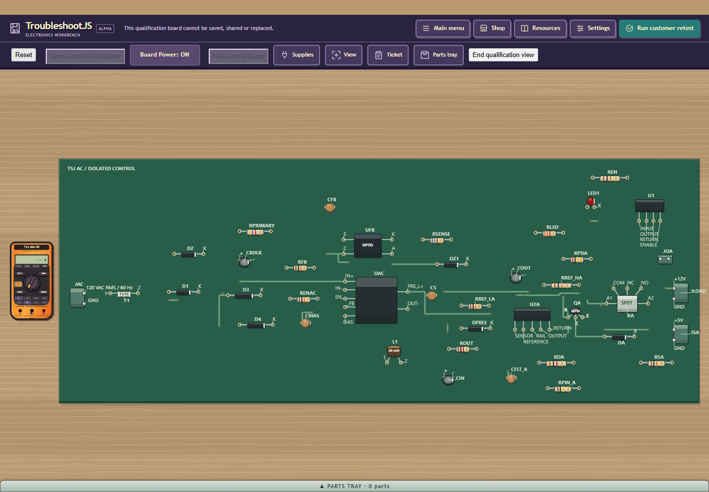
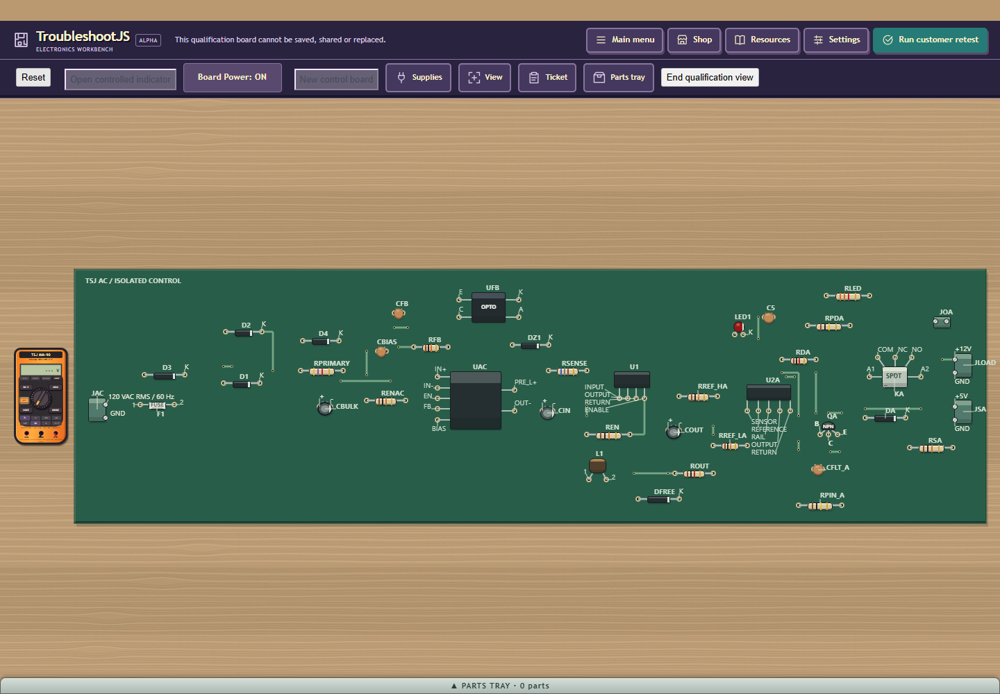
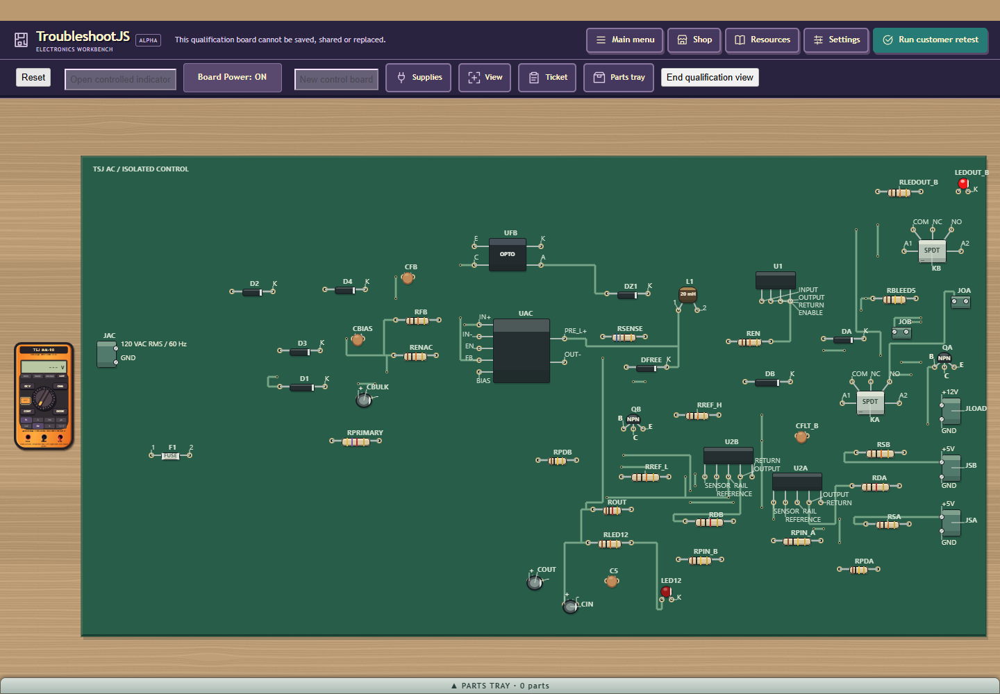

# V4 area-first PCB trial: rejected visual result

This is an engineering assessment, not an accepted production refinement. The
unpublished private4 candidate passed native196134.774s/eight suites (six current4
P07 admissions, six exact saved3 geometries), actual GWT52108.900s/all5 permutations,
and headed211181.361s for actual60/40/44 cold/fit/wheel/body input and retirement.
Build `11522DDFA25E5E8CE1E0025F3D6C9DF2`. Gates/inputs/typed failures in JSON.

The40 trial clusters functional parts and cuts group rectangle sum25.49%, copper
6.56% and area3.19%, but stretches the outline2.62:1->3.58:1. Root and independent
visual inspection reject it as an overall winner: fit-scale/readability suffer;
zoom around the control bank remains crowded. Connector access is retained;
no confirmed body/pad or required-text collision.44/60 geometry and60 fit PNG are
identical to accepted3. Reduced area is not visual acceptance.

At53, actual212 case PASS62.425s shows different grouping with some clearer
regions, but nativegroup/copper tradeoffs worsen. The entire212 gate is FAIL:
first54 cold proof timed out in HYPOTHESES at90,131ms,616 totalwork/495 hypothesis
units; HEALTHY30,052ms/HYPOTHESES56,871ms/maxunit1,787ms. No54render exists.
All seven product cleanup flags and browser/native retirement PASS. No prior54
cold reference is claimed; native3/4 geometry does not replace missing cold proof.
No causal regression inference or deadline waiver. Native193/194/195 failures
remain FAIL with their concrete route/fixture/60s host reasons.

Five useful actual fit captures were inspected. These show no selected diagnostic
answer. Accepted53 comes from retained headed205 raw capture (buildBB9CE498...);
it was not freshly rerun. Existing accepted40/60 images are linked rather than
duplicated. Counts/seeds:40/-1017,53/17,60/-1022.

Next is one scoped v4-only choice among already routed legal layouts: shorter
longest outline side before existing area/quality ties. It adds no routing or
placement attempts, keeps both roomy fallbacks and every old1/2/3 selection rule.
It is pending native/build/actual render proof. Native tests are not visual
acceptance. Candidate code is uncommitted; this packet publishes the assessment.
U05 human NOT RUN/HARD/public RB56 held/modest-host owner-deferred. Original8 exact,
no email/Core/Android/C4130/GPU/main merge/Q30 corpus rerun. Evidence SHA `8878bd6c2b63ee9192bf70746e70588b785021838aecf1da8dd20a3fedf5cd86`.
