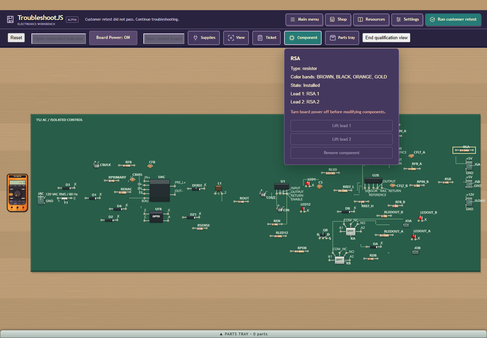
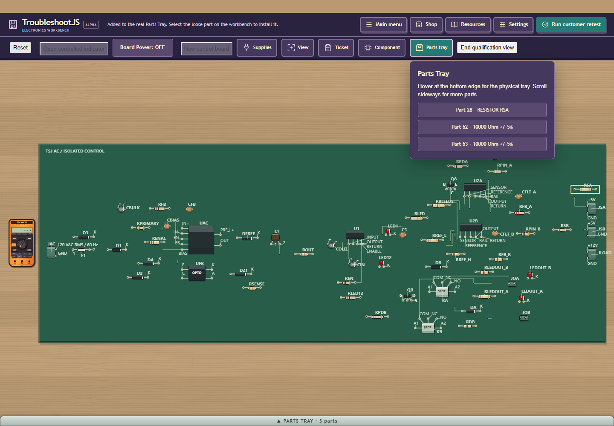
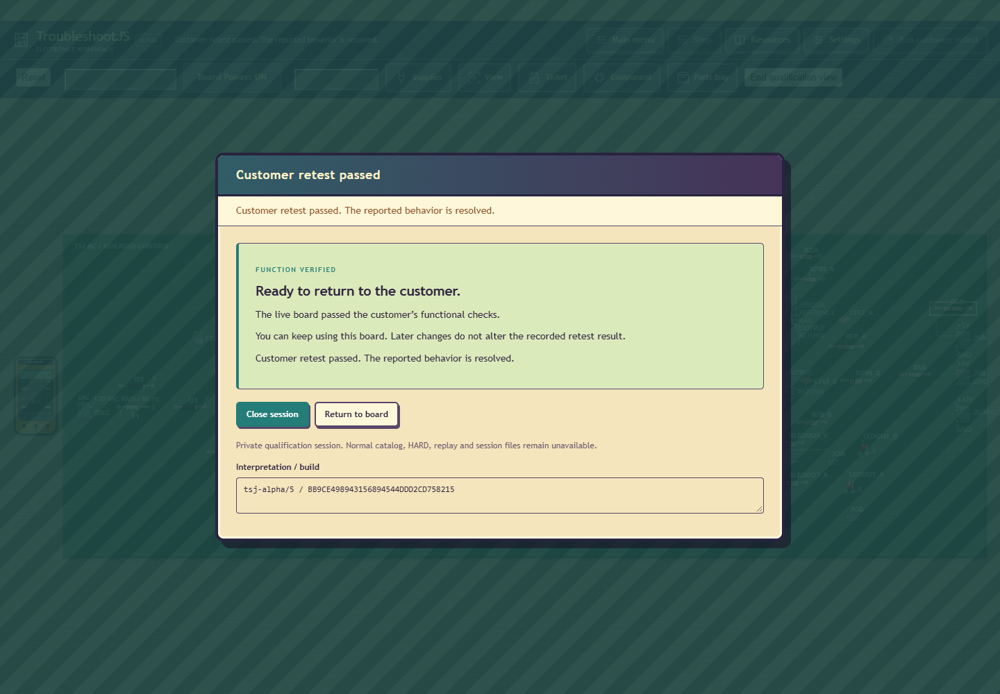

# Current 60-part interactive repair, placement 3

PASS for the fresh current production layout from `525626df`, after evidence-only
`5411c7a4`, build `BB9CE498943156894544DDD2CD758215`. This closes the final
automated interaction check for this PCB revision. It is a source-guided software
fixture, separate from Dave's unrun U05 human trial and normal release acceptance.

One maintained headed Edge / localhost session used ordinary ticket, board power,
Board view selection, Component, Shop, Parts Tray, customer retest and Close session.
Native owner `compiled-r210` PASS 124.167s;
player operation 120.842s; retained interaction
34.778s. Fresh cold setup 84.462s,
626/640 work, max unit 1.323s,
5 hypotheses and 60 solver samples. Product limits remain90s/640/5s and360s hold.
All21 frozen source/test files and1564 source/served files remain exact; published
native192/GWT50 evidence is reused within that audited boundary. No rebuild or A/B
comparison was repeated. No production code or electrical/routing rule changed.

The powered unrepaired customer retest failed. RSA's public BROWN/BLACK/ORANGE/GOLD
bands decode to10000 Ohm +/-5%. Remove was disabled while power was ON. After
ordinary OFF, the real residual-energy readiness guard enabled Remove within
8.887s (initiallyEnabled=False); no fixed
discharge delay or mutation injection. Shop acquired exactly three equal-spec
unformed axial stocks. Each exposed one enabled `Install as Channel A / RSA`
target. Only first actual stock Part61 was installed and retested; this does not
claim three physical installations. Original Part28 and unused Parts62/63 stayed
loose. Actual repaired powered customer retest PASS, visible RESULTS, then Close.
All seven owner/meter/debug/coordinator/session/bridge cleanup flags and UI absence
witnesses PASS; browser/server/native handles exited with no owned survivors.

Retained collector209 FAIL: cold passed83.714s/626/max1.262s, but the task collector
asked for post-retirement `jobOutcome` before retirement. No repair inputs ran.
Corrected210 uses the phase-correct HOLD/coldProof/fullProductionD01 fields.
209 application retirement is UNPROVED; browser/native cleanup PASS. Its failure
stays FAIL. Historical199/201 timeouts and Q30 unknowns remain unchanged.

Root inspected these three engineering captures (they reveal the source-guided
repair target and are excluded from blind human screenshot delivery):

Current curated40/42/44/53/60 cold/render/input proof;44 and60 current actual
service/retest proof;54 native routing only. Current44 saved1/2/3 proof remains
separate. U05 human NOT RUN, HARD/public normal RB56 release HELD, normal population
NOT RUN, modest host owner-deferred/RPG shelved. No reliability/optimal-layout claim.

Dave's20:55UTC priority is continued generation/PCB realism. Next: one new
interpretation candidate that scores region cohesion in fallback placement while
preserving saved3 geometry; assess real native routing and rendered density before
acceptance. General roadmap advancement pauses for this priority.

Dave's fault-neutral40/44/60 fit captures have anonymous HTTP200 image/png links
byte-verified at immutable5411c7a4; URLs/digests/counts in evidence JSON.
Library upload helper is BLOCKED: `Library prepare_uploads is not available`;
no Library mutation or file ID claimed. Verified image links support Android.

Evidence SHA256 `e6be76a23ed014150418ca906754e27156243b91cb0d6d462f3996ce0d4e8d81`. Eight original untracked files/accepted saves preserved;
no owned runtime remains. No email/Core/Android/C4130/GPU/main merge.
