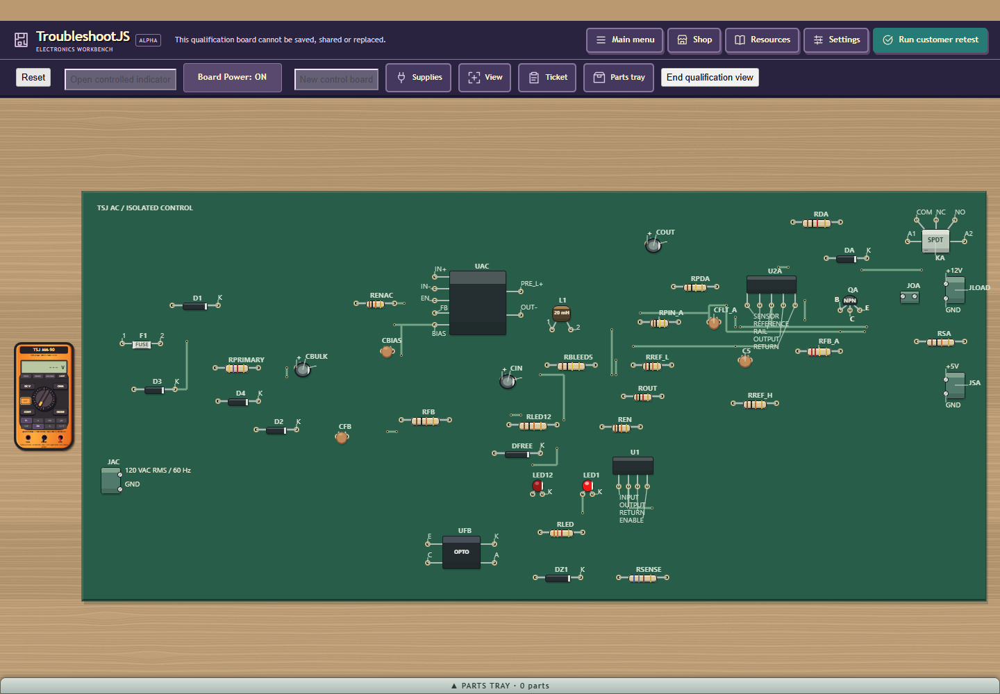

# PCB density screenshot checkpoint

Actual GWT55 build C335F8DD621095BD904B15E9B3334D49, private placement4.
The 44-part board retains every component with 22.91% less area. Root and
independent fit/zoom inspection found tighter packing, readable complete labels
and accessible edge connectors. The 60-part board still uses its accepted roomy
P07 geometry; its new capture is byte-identical to the linked accepted image.

Native199 passed eight suites, GWT55 passed all five permutations, and headed216
passed four actual render/input cases. Headed217 passed real private3/4 file
restores, source/history/geometry checks, Shop repair, powered retest and Close.
This checkpoint publishes actual screenshots and engineering evidence.
Candidate code remains uncommitted: the 42-part board's terminal bank needs more
lower-edge breathing room. A presentation inset preference is being refined
before source publication. Gate durations and receipt hashes are in evidence.json.
Original limits remain; no all-board density, human U05 or normal release claim.

