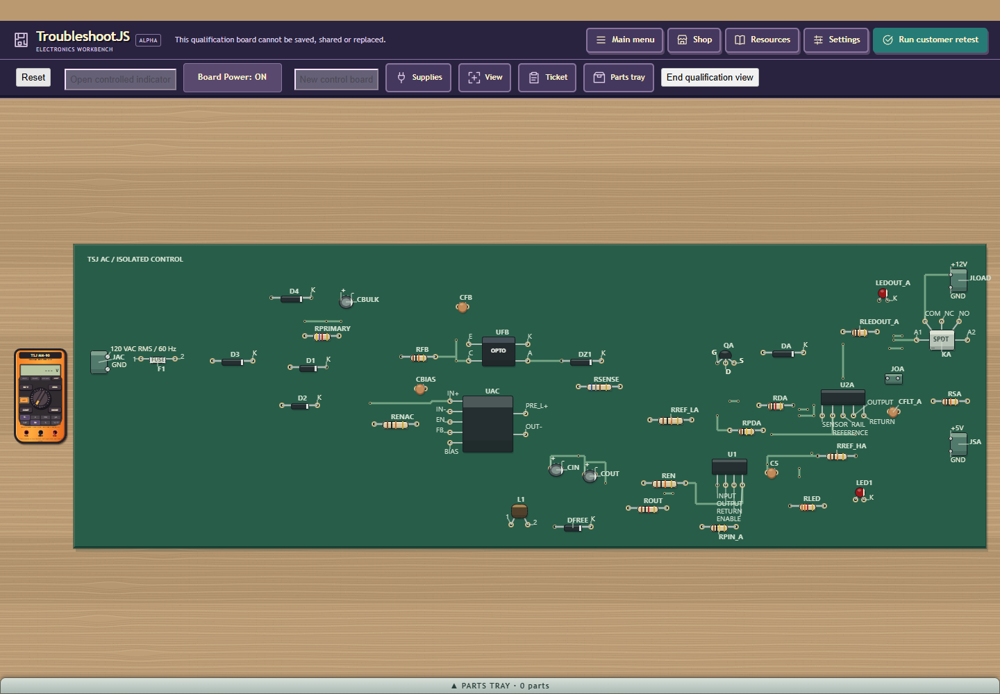
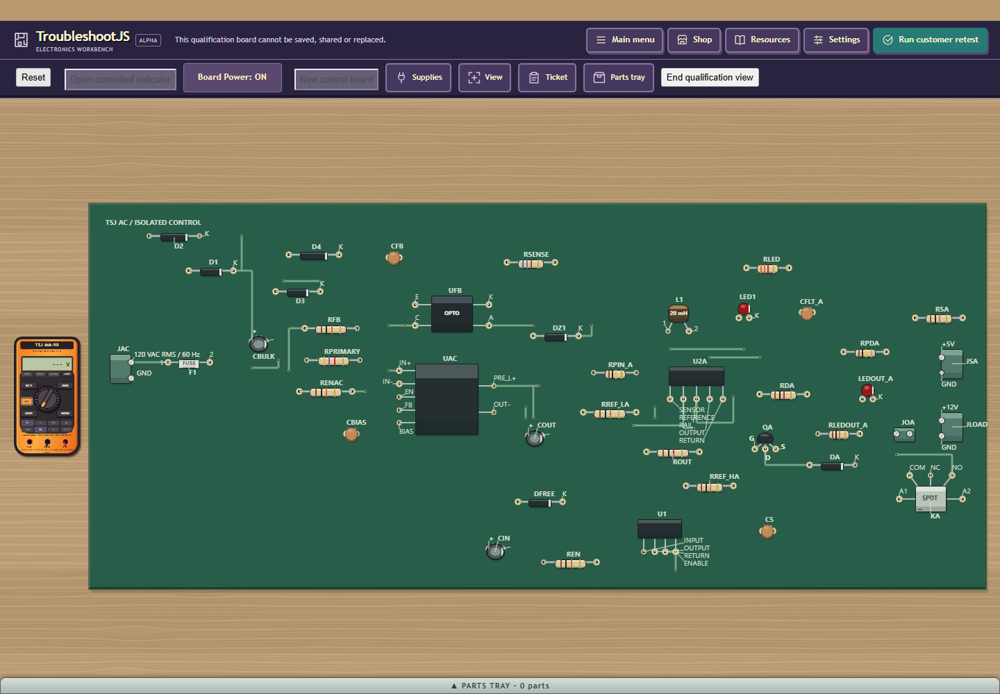
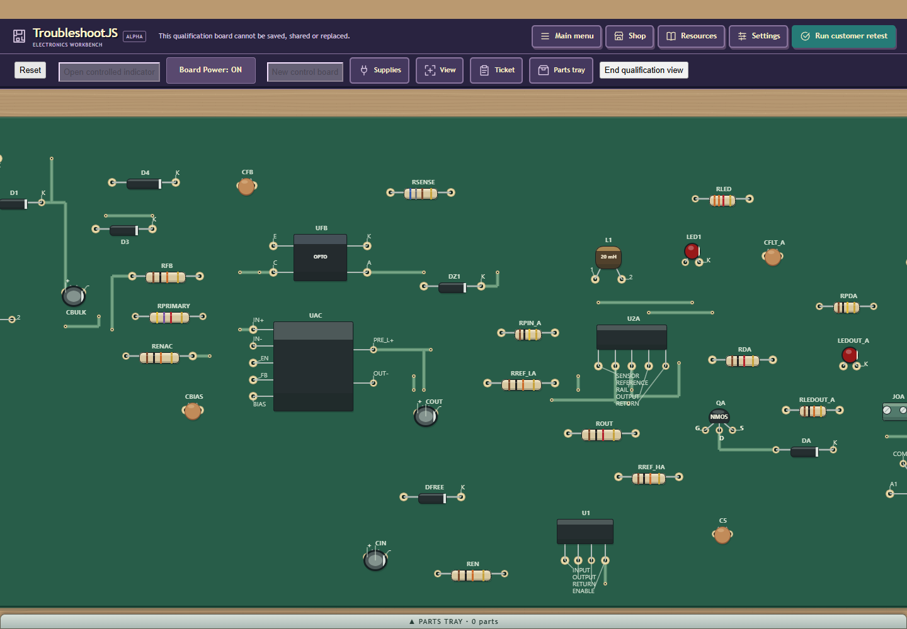
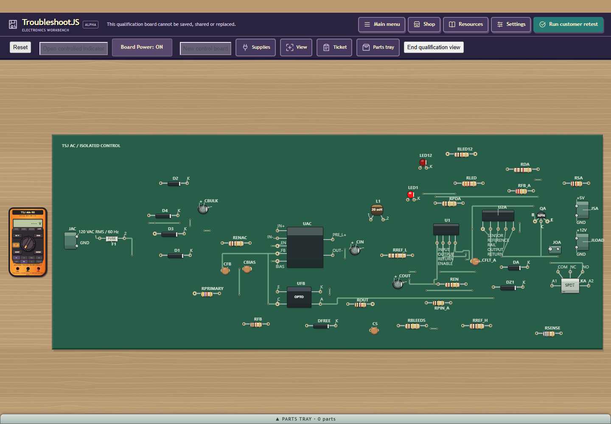

# Private PCB density and label inset

Accepted finite private placement 4 refinement, retaining every component and pad.
The 44- and 42-part boards are materially tighter at fit; complete terminal names
remain readable. The 42-part lower-edge U1 bank now uses an existing legal inset
column. The 60-part board retains its exact accepted roomy P07 geometry. Density,
locality, copper length and via tradeoffs are mixed; no all-board win is claimed.

| Parts | Seed | Prior 3 area | Current 4 area | Change |
| --- | --- | --- | --- | --- |
| 40 | -1017 | 5234628 | 5245799 | +0.21% |
| 44 | -1004 | 6516729 | 5023809 | -22.91% |
| 60 | -1022 | 9982329 | 9982329 | +0.00% |
| 42 | 0 | 6272745 | 4997115 | -20.34% |
| 53 | 17 | 7715488 | 7708262 | -0.09% |
| 54 | 42 | 8561514 | 7348152 | -14.17% |

Areas are drawing units squared, not manufacturing dimensions. All six actual
native layouts pass P07/RB56 admission with complete part/pad census. Saved 3
literal geometry oracles and saved 1/2 contracts pass. Native 199/eight suites is
reused only for eleven unchanged core inputs; native 200 freshly verifies 273
label assertions. Final JDK8/GWT 56 passes all five permutations. Headed 218
freshly verifies 60/40/42/44 cold preparation, fit, real wheel and physical U2A
selection, full-reference coverage, no required visible ink collisions and
complete product/browser retirement. Its deliberately unrepaired customer
result is FAIL, as required; render-host PASS does not mean customer PASS.

Headed 219 uses real Save downloads and FileReader selection for fresh 4 ->
accepted 3 -> fresh 4. Resaves preserve each requested layout, source 250 mA and
three-entry semantic history without importing completion. Ordinary unrepaired
retest FAIL, guarded power-off relay removal, public Shop replacement, retained
original tray part, powered customer retest PASS and Close restoration all pass.
This is source-guided engineering evidence; U05 human remains NOT RUN.

Original 90s/640-work/5s/360s hold, 60s per JVM, six placement candidates and
three routing candidates per policy remain. Current 53/54 cold/render NOT RUN;
54 density is native-only. Prior 193/194/195/198 failures and the prior 212 54-part cold timeout
remain FAIL; old R4 ribbon remains visually rejected. Public HARD/RB56 and
normal population release stay HELD; modest-host is owner-deferred. Q30's
historical 91.616 s unknown failure, six missing scratch inventories and late
audit limitation remain. No unchanged corpora, email or other-repo work.

Exact source, build, receipt/image hashes, cold results, mixed geometry metrics,
real file/repair evidence, root review and limitations are in evidence.json.
Raw ownership/log records stay in task storage; only portable data is committed.

