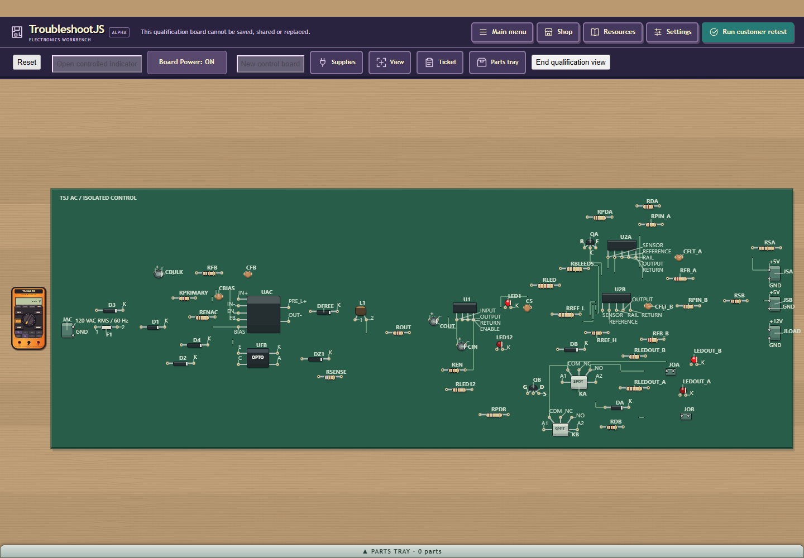
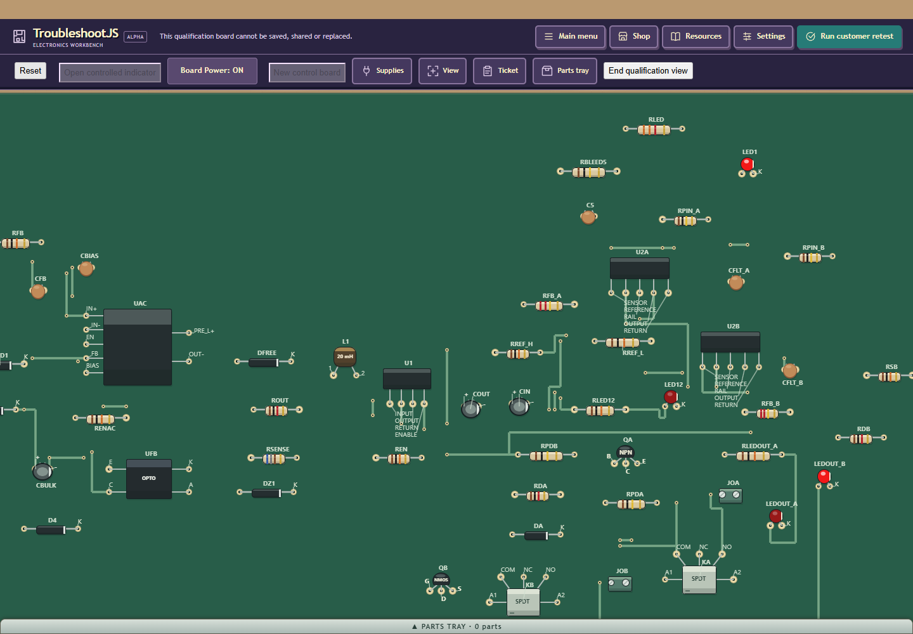
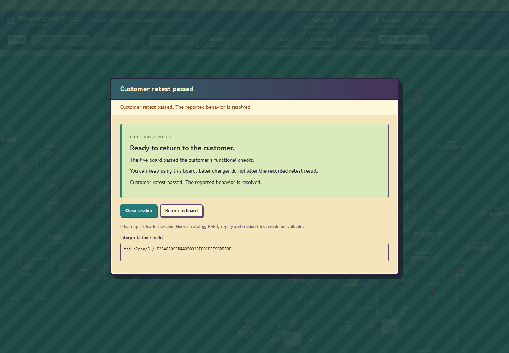

# Private5 larger-board density

The same 60 and 54 components occupy 15.41% and 13.29% less board area than
accepted private4. Every part/pad remains, with actual P07/RB56 admission.
40/42/44/53 retain exact accepted4 geometry. This is a finite refinement;
Dave's aspiration for another 30% and visibly tighter 42/44 remains unmet.

| Parts | Seed | Prior4 area | Current5 area | Change |
| --- | --- | --- | --- | --- |
| 40 | -1017 | 5245799 | 5245799 | +0.00% |
| 44 | -1004 | 5023809 | 5023809 | +0.00% |
| 60 | -1022 | 9982329 | 8443994 | -15.41% |
| 42 | 0 | 4997115 | 4997115 | +0.00% |
| 53 | 17 | 7708262 | 7708262 | +0.00% |
| 54 | 42 | 7348152 | 6371585 | -13.29% |

Areas are exact drawing units squared, not manufacturing dimensions. The
planner uses existing full package/access demand. Repeated declared control
groups use moderate4; single groups retain tight0/1. Compact2/3 and roomy5
remain within the same three routes. The moderate profile uses twice protected
demand with the existing allowance. No seed/part-count special case, new
router algorithm, expanded search, smaller package, deleted part or copper crop.

Remote fallback silkscreen positions could enlarge a routed board: the first
moderate 60 route finalized 11.43M area although its unlabeled occupied extent
looked smaller. First crop validation passed; access guards were not the cause.
Private5 tries the original scan's content-near full-text candidates first, then
the remaining original positions once. All fonts/copper/geometry validators stay.

The tighter profile trial's cheap ranking grew 42 by 39.70%; structural native
PASS did not count as density acceptance. That candidate was rejected before
build/render/publication. Single-group literal40/42/44 oracles now prevent that
regression. Actual rejected/diagnostic receipts remain in the portable evidence.

| Parts | Prior protected free cells | Current protected free cells | Largest current empty rectangle |
| --- | --- | --- | --- |
| 40 | 49.7% | 49.7% | 1130 x 390 |
| 44 | 47.7% | 47.7% | 850 x 540 |
| 60 | 63.0% | 56.9% | 1310 x 670 |
| 42 | 49.4% | 49.4% | 1340 x 490 |
| 53 | 54.8% | 54.8% | 2030 x 900 |
| 54 | 52.7% | 47.6% | 650 x 910 |

Whitespace is sampled at 10-unit grid resolution after reserving package access,
both copper faces, vias, model labels and isolation strips. Empty cells do not
prove a move is routable or that a rectangle can be removed from a rectangular
PCB. Actual 42/44 still have large sparse left/top/lower regions. Reaching the
remaining target needs placement reflow and routing, not another zoom/crop.

Native207 current6 plus session/identity/backing/dependency contracts PASS.
Its generator/replay/routing/copper/access scope remains unchanged after the
later four-file camera-only correction; it does not prove current fit behavior.
Fresh native208 passes 1277 independent U01 viewport assertions.
Six exact old3 and six exact old4 geometries from206 are reused only across the
unchanged version<5 branches; unused diagnostic selector removal changes none
of207's selected suite or bridge behavior. Label owner/fixture remain byte-exact
from native200. Final actual JDK8/GWT58/all five permutations PASS. Prior headed220
passes fresh 60/42/44/53/54 cold/render/input under GWT57 before the later
fit correction;54's clipped initial fit was explicitly withheld from acceptance.
60 also completes actual unrepaired FAIL, public 10k resistor stock acquisition,
power/residual guard, physical RSA replacement, tray retention, powered retest
PASS and Close in that same session. Other views close with the exact deliberate
unfinished-customer FAIL and complete resource restoration. Final browser223
checks 60/54 initial fit and real Fit bench with actual DOM tray bounds, complete
outline/retained margin, wheel/body-selection/full-label coverage and cleanup.
It uses headless Edge to preserve desktop focus; screenshots are actual compiled
UI renders, not a human trial or OS-input certification. Final browser221 performs
fresh5 -> accepted4 -> fresh5 real FileReader/resave, source/history/geometry
preservation without completion, ordinary relay repair/retest/Close PASS.
These are source-guided engineering flows, not human U05 calibration.
Both final browser gates use headless Edge to leave desktop focus unchanged.
Collector222 remains FAIL: it requested the visible caption View rather than
the existing accessible name Board view. Initial 60 passed; Fit bench/54 were
not reached. Corrected223 changes the accessible selector and mechanical phase/output
identity only, with no source/build/limit change; the failed host/browser receipts and complete cleanup are retained.
The four-file fit correction reserves 24px collapsed or current expanded tray
height through the shared initial/Fit bench path, keeping actual viewport and
hit bounds and world/save geometry unchanged. The prior 4px 54 overlap is retained
in the [historical pending packet](../density-v5-pending-r1/README.md).

All 90s/640-work/5s/360s hold,60s JVM and six-placement/three-route caps remain.
New 53/54 cold coverage does not erase the old 54 timeout. Public HARD/RB56 and
normal population release stay HELD; modest-host remains owner-deferred. No
unchanged Q30 corpus or cold A/B loop, Core/Android change, email, main merge,
global process action or interference with ServerCenter's ADB/tablet.

Dual-sided components are authorized and assessed, but not implemented here.
Existing bottom-pose mirror, face switching and PTH probing/conductors are useful.
The planner currently rejects overlapping envelopes across faces; standard
RB56 packages allow TOP only. A focused private6 path can enable versioned axial
packages and side-aware placement, with explicit protruding through-lead/access
shadows against opposite-face bodies. Projected bodies alone may overlap across
faces. Keep isolated converter/opto packages top and preserve old package
dependency bytes; do not infer real mechanical clearance from copper layers.

