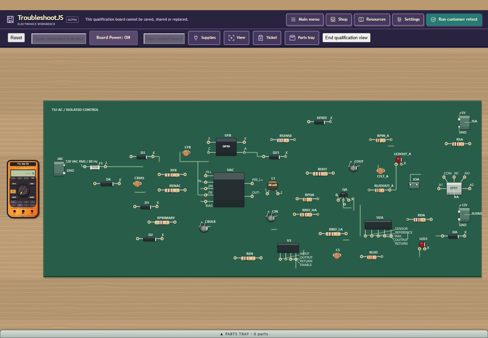
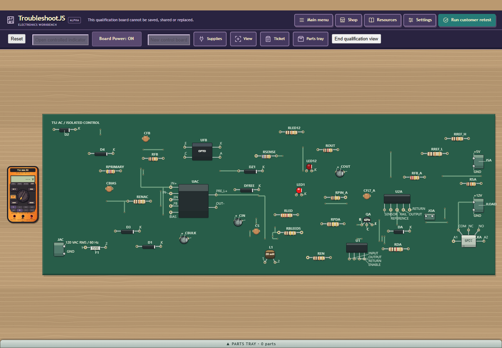
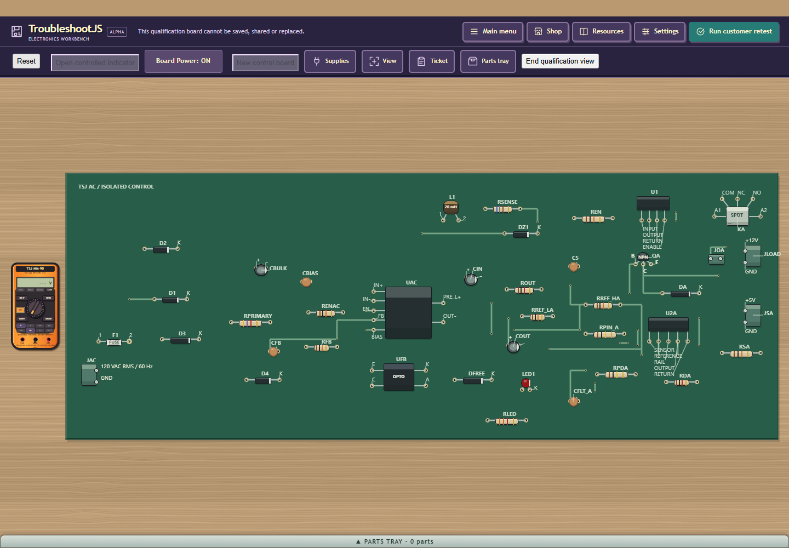
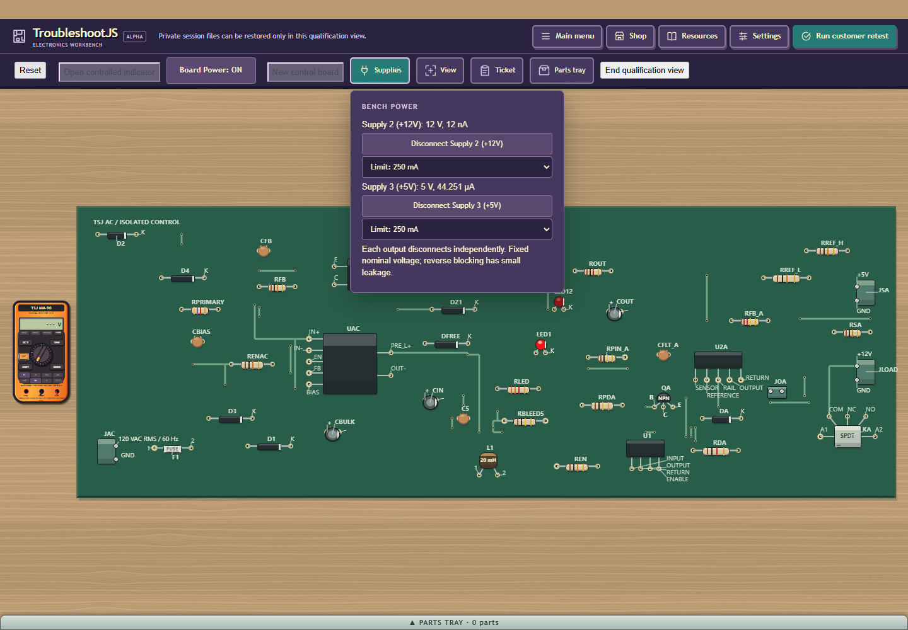
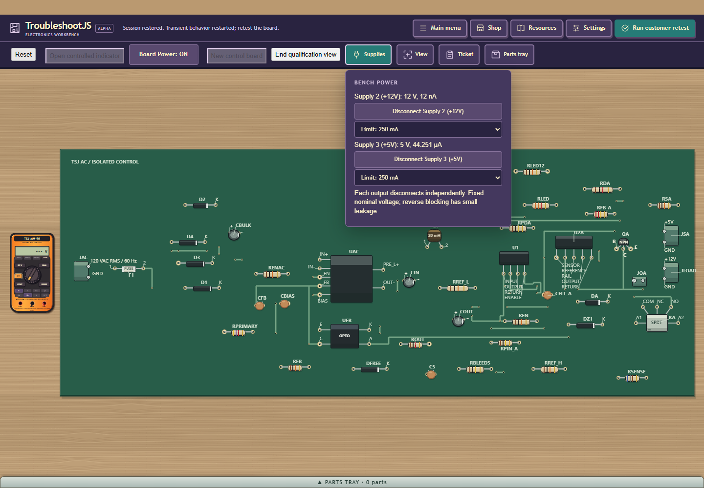

# Private6 single-group compaction

All parts/pads remain. Same-seed42/44 outlines use6.35%/7.99% less area than
accepted5;40 improves2.36%.60/53/54 retain exact accepted5 geometry. Drawing
units squared are not manufacturing dimensions. Dave's additional30% target
remains an aspiration, with visible internal whitespace still present.

| Parts | Seed | Accepted5 area | Current6 area | Change |
| --- | --- | --- | --- | --- |
| 40 | -1017 | 5245799 | 5122184 | -2.36% |
| 44 | -1004 | 5023809 | 4622400 | -7.99% |
| 60 | -1022 | 8443994 | 8443994 | +0.00% |
| 42 | 0 | 4997115 | 4679776 | -6.35% |
| 53 | 17 | 7708262 | 7708262 | +0.00% |
| 54 | 42 | 6371585 | 6371585 | +0.00% |

The existing planner's group-centre/source-lane behavior now also applies to
private6 tight0/1. It routes both existing tight alternatives and provenroomy5
for single declared groups, comparing actual finalized crops. Repeated control
groups keep their accepted5 prefix. No seed/count predicate, new routing/search
algorithm, reduced package/access/clearance/font or part/copper omission.
Six placements and three routes perpolicy remain. Both component sides were
assessed as authorized options; this finite TOP-only change does not need or
implement backside mechanics. Saved1-5 retain their explicit interpretation.

The first trial209 passed structural checks but made44 area14.83% larger;
it was rejected before build/render. Its selected preliminary route looked
better before final cropping.211's unchanged3-route budget compares both real
tight crops, and212's six current layouts have no outline regression versus5.
Current locality/copper/via metrics are mixed:42 copper length grows2.78% and
its group extent grows, while44 copper length falls0.92%. Outline improvement
does not imply every locality metric improved or a causal speed improvement.

| Parts | Prior largest protected empty rectangle area | Current area | Change |
| --- | --- | --- | --- |
| 44 | 459000 | 176400 | -61.57% |
| 42 | 656600 | 376200 | -42.70% |

The10-unit conservative raster reserves full package/access envelopes, copper
on both faces, vias, model labels and isolation. Its empty rectangle is an
internal-gap measure, not guaranteed packability or removable rectangular PCB
area.42 still has upper/right and lower/left pockets;44 has smaller spare gaps.

Native211 PASS29.790s: focused42/44 (431 assertions) and unchanged backing owner (205 assertions).
Native212 PASS88.580s: six current P07/RB56 admissions1488 assertions, six literal
saved5 geometries1499, U06 saves34957, private identity92 and dependency capture
1166. Existing1-4 semantic branches/literals and label/fit owners were audited;
prior206 geometry,200 labels273 and208 fit1277 assertions are reused within
that unchanged boundary. Full native/global population matrix NOT RUN.
Final actual JDK8/GWT59 PASS92.251s/all five permutations; served/save strong
name A699B3336850CA2E595F0123DA59CAEB.

Headless Edge224 PASS110.944s uses actual compiled input for initial fit,
ordinary Board view/Fit bench, wheel zoom and physical U2A body selection.
40/42/44 cold generation is28.096s/31.054s/34.580s, work520/521/518, maximum
unit0.992s/1.078s/1.070s. All nine views preserve full references and fully visible
required ink;44 additionally matches the prior literal74-text census.40/42 have
no prior literal terminal census. Root and independent review accept the fit
images: full outlines clear tray174/156/186px, no40 skinny-ribbon regression.
The44 zoom's reported120VAC/1 pair is wholly left of the canvas; zoom naturally
crops the input edge. Fit shows the complete input. Banks are small at fit and
readable when zoomed. Views close with deliberate unrepaired customer FAIL and
all cleanup flags; host PASS is not a customer retest PASS or human trial.

Headless225 PASS125.446s (actual case122.302s) performs fresh6 Save, accepted5
real FileReader/resave and fresh6 FileReader/resave. Version identity, full
realization,250mA source and three-entry semantic history remain, without
completion on import. It then performs ordinary unrepaired FAIL, power/residual
guard, public relay Shop acquisition, physical KA removal/tray/install,
powered customer retest PASS and Close with all seven restoration flags.
The raw observation caption fresh-placement5 is stale; its strict replay and
actual download are6. Receipt remains unchanged with that limitation explicit.
These are source-guided engineering flows, not human U05 or OS-input certification.

All90s/640-work/5s/360s hold,60s JVM and route/evaluation limits stay.60/53/54
current world geometry is exact5; prior5 cold/render/service evidence is reused,
not rerun. Older failures remain in [accepted5 and historical packets](../density-v5-r1/README.md).
Q30 unknown91.616s failure,6 missing scratch inventories and late audit persist.
HARD/normal RB56 HELD, U05 human/normal population NOT RUN, modest-host owner-
deferred. No unchanged Q30 corpus, email, main merge, Core/Android or unrelated
process/focus/ADB/tablet work. All owned resources retired; original8 untouched.

Before screenshots are actual private5 GWT57/source220; their world geometries
match the saved5 literals in212. They use an earlier fit inset than current59,
so exact native dimensions/area establish reduction; screenshots show placement.

