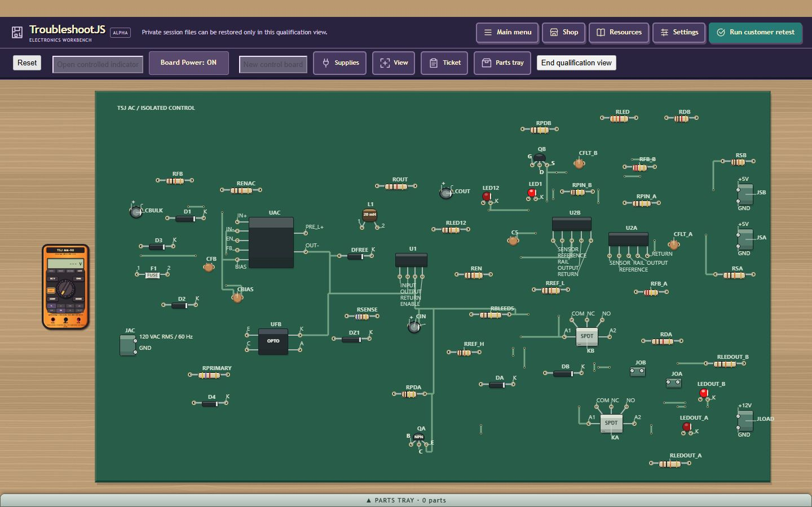
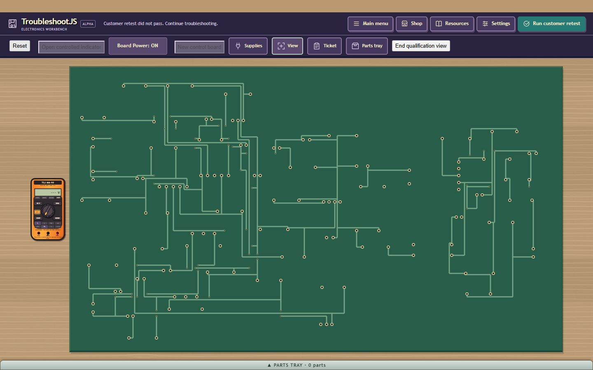
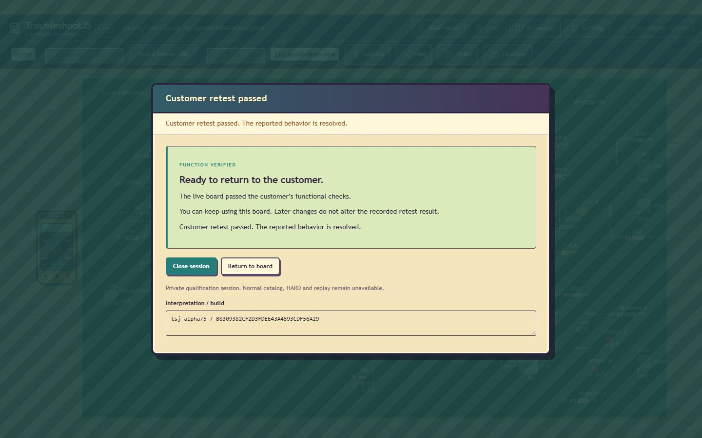

# Guarded route coverage and private7 60-part compaction

Continuation of the rejected-domain-trial checkpoint on base `24cf8482`, branch
`codex/q60-faulted-profile-counts`. This corrects preliminary ranking displacing
the retained compact route; no new domain geometry trial or broader milestone
is started. The enclosing commit identifies the accepted source candidate.

For repeated control regions, private7 routes the unchanged moderate4 and compact2
placements first. Slot three keeps roomy5 until that **same routing policy** has
validated a route; after success it may examine the best remaining placement.
P05 success cannot authorize P07 exploration. Missing retained placements keep
the existing fallback slots. All legal placements and their original scores remain
in the receipt, and actual route outcomes identify the dynamic third request.
The selected layout still uses the existing final crop/quality comparison.
Single groups preserve the established0/1/5 policy. Six placements, three routes
per policy,60000 placement evaluations,90s/640 work/5s units and360s retained
qualification hold remain. No router, clearance, service, package, isolation,
electrical, seed, canvas, label or viewport implementation changes.

| Parts / seed | Accepted6 area | Private7 area | Change |
| --- | --- | --- | --- |
| 40 / -1017 | 5122184 | 5122184 | exact geometry |
| 44 / -1004 | 4622400 | 4622400 | exact geometry |
| 60 / -1022 | 8443994 | 7395541 | -12.42% |
| 42 / 0 | 4679776 | 4679776 | exact geometry |
| 53 / 17 | 7708262 | 7708262 | exact geometry |
| 54 / 42 | 6371585 | 6371585 | exact geometry |

Drawing units squared are not manufacturing dimensions. The60-part board keeps
all60 packages/143 pads; dimensions change4111x2054 ->3571x2071. After P07
moderate4 succeeds, candidate1 now receives slot three and passes. The53-part
regression first rejects4, succeeds2, then rejects experimental0;2 remains
accepted. All six saved6 hashes remain frozen and exact. Existing saved1-5
branches retain their source behavior; fresh7 and explicit saved6 are distinct
before plan-cache/proof reconstruction. Publicalpha5/sessionmodel1/epoch16 stay.
No arbitrary-seed success guarantee, optimal packing or additional30% completion
is claimed. Full native/global population, human U05, modest-host proof and
normal HARD/RB56 release remain NOT RUN/owner-deferred/HELD as previously recorded.

Validation uses the maintained selected JDK8/native commands:

```
scripts/verify-current-contracts.ps1 -JavaHome <JDK8> -Suite @(
  'PcbGuardedRouteSelectionContractTest','RelBSessionIdentityContractTest',
  'U06SessionSaveContractTest')
scripts/verify-current-contracts.ps1 -JavaHome <JDK8> -Suite @(
  'PcbFunctionalGroupingContractTest','PcbSavedSingleGroupGeometryContractTest',
  'Rb56DependencyCaptureContractTest')
scripts/build.ps1 -JavaHome <JDK8>
```

Native PASS: adversarial selection7932 assertions/all720 rankings, save34960,
identity100, current physical/admission1498, frozen saved6 geometry1494 and
actual full dependency capture1166. Each native phase exits0 and proves scratch
cleanup. The final identity message-only correction is separately rerun; its
semantic assertions and production inputs are unchanged. An independent reader
checks all twelve geometry rows, frozen prior hashes, every actual policy route
chain, uniqueness/caps and policy-local successes. Its first overly strict
all-current-hashes-equal assumption FAIL is preserved as an audit limitation:
the60-part improvement was then explicitly identified, not blessed as equality.

Actual final-source JDK8/GWT PASS all five permutations,89.881s compile/2.749s
link; served strong name `B8309382CF2D3FDEE43A4593CDF56A29`.

Built-in Browser,1440x900 desktop qualification, real UI:
60-part cold proof PASS75.921s/589 work/1.389s max unit, five hypotheses/60 solver
samples/six stages. Accept ticket, initial complete bench fit, actual underside,
powered unrepaired retest FAIL, normal U1 OUTPUT red/RETURN black DC reading
4.996V, actual RSA-body click/public BROWN,BLACK,ORANGE,GOLD markings and powered
Remove disabled. Power OFF; actual Save download -> actual FileReader restore
PASS77.213s/589 work/fresh owner/prior owner retired. Shop acquisition of a public
10000Ohm5% resistor, unpowered Remove, retained original in tray, compatible
Install as Channel A/RSA, power ON, customer retest PASS and Close. All seven
owner/meter/debug/coordinator/session/bridge cleanup flags PASS. Raw425.469s wall
includes75.921s cold preparation; retained interval349.548s is within360s. This
is an engineering/source-guided repair, not human difficulty calibration or
OS/CDP-wrapper certification. No injected controller mutation was used.

The existing6 file check and its compact raw receipts are recorded in
`browser-final44.json` and `saved6-resaved44.tsjsave`. Restore PASS37.449s
with fresh owner/prior owner retired. Replay, realization, history, sources,
damage and fuses remain exact. The live serviceTime counters advanced before
resave; build and resulting state signature change. The initial build-only
comparison FAIL is corrected by the exact changed-field audit in
`saved6-comparison.json`. The intentionally unrepaired customer retest and final
closure remain raw FAIL; all seven cleanup flags PASS. This is scoped restore
proof, not a second whole-flow PASS. Initial chooser timeout
is a browser automation FAIL, not a product PASS; it is retried only after the
actual Load menu is inspected. Earlier Locator deadlines (3s during preparation;
waiting for a Component popover before opening its actual button) are similarly
retained as automation limitations. Product cold, restore and final-cleanup
receipts determine the acceptance results. No page errors were observed.

Root reviewed source/test diff, actual images and independent receipt comparisons;
no independent agent review. Before60 image is the actual accepted5/6 world
geometry from GWT57 with an earlier fit inset; exact native dimensions quantify
the gain. It is not a fresh render or new baseline build. After60 fit/underside/
results and saved6 view are fresh production input captures. Geometry remains
visually sparse in places; no manufacturing or globally optimal routing claim.
Earlier rejected packing trials, Q30 unknown91.616s failure, six missing scratch
inventories and other historical limitations remain untouched.

The task-owned preview/tab/viewport and scratch are cleaned after receipts are
retained. Existing qualification-worktree untracked evidence/cache files and the
Desktop checkout's seven tracked edits/untracked data remain preserved. No main
merge or completion email, retaining the prior continuation's publication scope.
Next: a narrower primary/mixed-boundary geometry trial can now be tested without
cheap-score eviction of4/2; preserve those fallback owners and every current cap.
General roadmap advancement remains behind the PCB realism priority.





