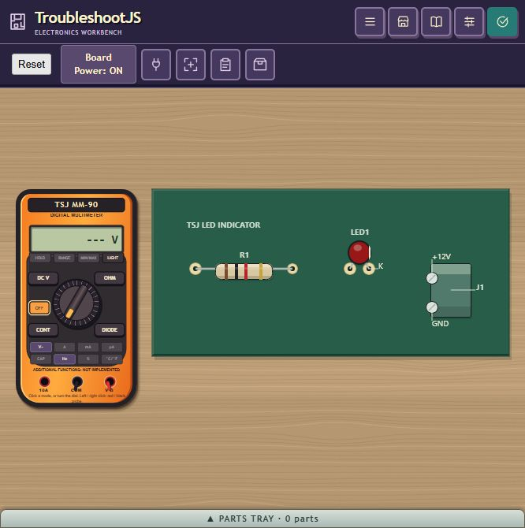
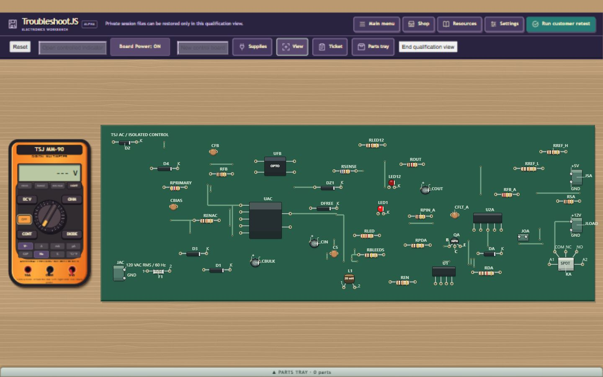
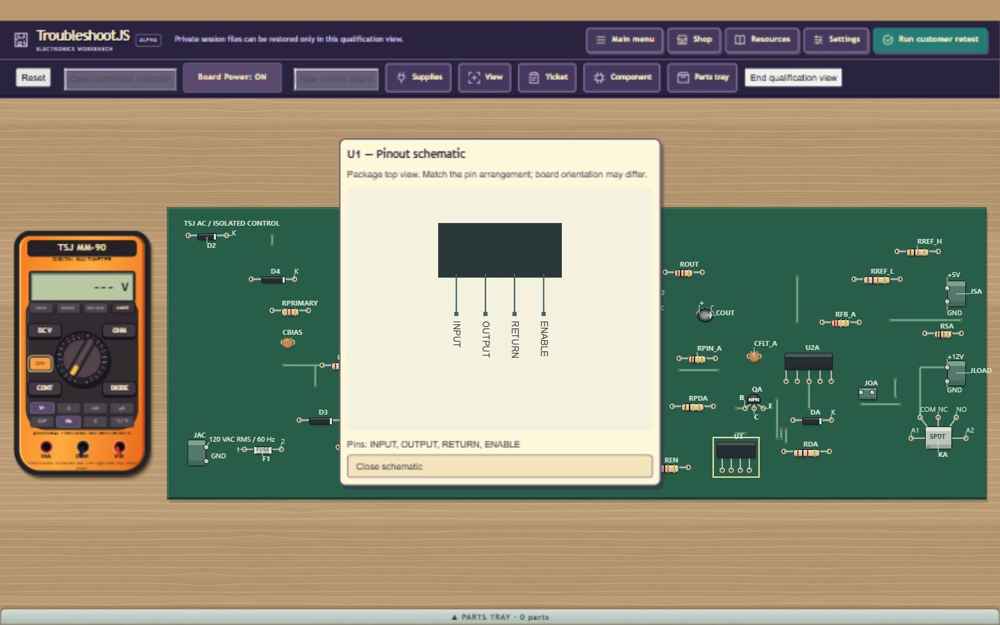
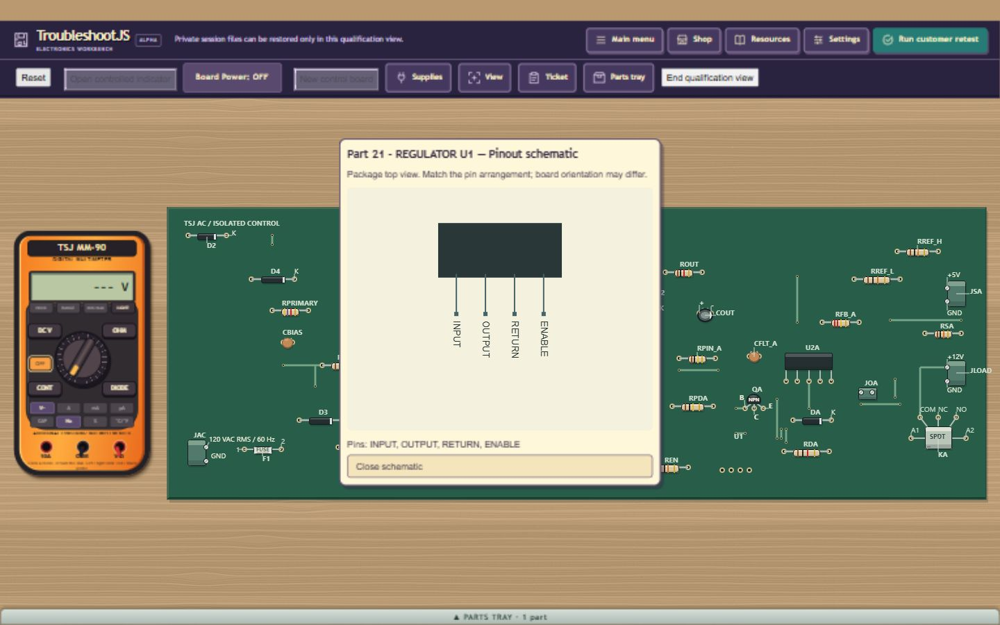
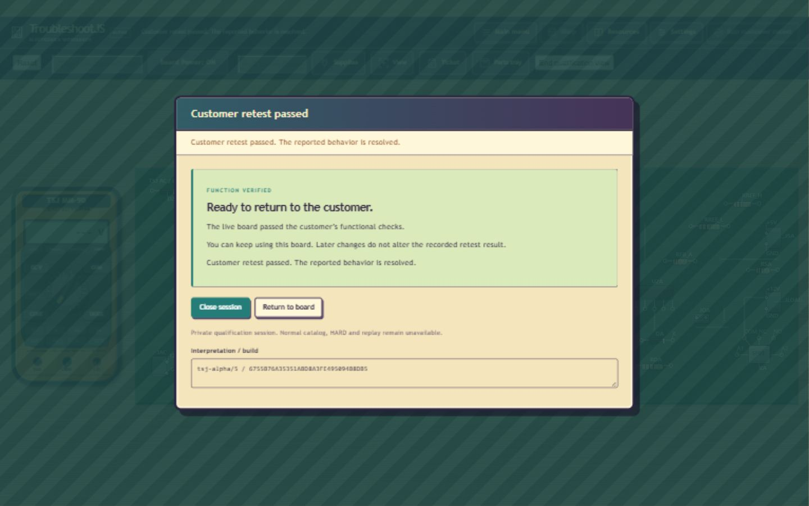

# Board-relative multimeter and chip pinout menu

User-requested presentation scope on base `32451a07`, branch
`codex/q60-faulted-profile-counts`. The enclosing commit identifies final source.
The meter's case uses the greater of 454 drawing units, 75% of PCB height and
30% of PCB width, preserving case proportions and separation. Fit bench includes
this actual envelope; the DOM converts case width to CSS scale once. Permanent
camera, world placement, drag mapping, flip/loupe separation and native meter
ownership remain. No PCB realization, graph, seed epoch or measurement changes.

Regulators, decision controllers, optocouplers and isolated converter modules
omit their individual pin-name annotations on the bench. Physical leads/pads,
reference names and conductor targets remain. Right-click the chip body opens
its existing action menu; **View schematic** opens a public top-view package
pinout with named leads and an accessible pin list. It consumes canonical package
geometry only, with no board wiring, fault/answer or live measurement state.
Current owner, menu lease, same registered part and installed/loose state guards
reject stale callbacks. The same View schematic entry works for loose tray chips.
The existing popup cleanup owner handles close/detach/reset. Conductive right
clicks in meter mode still place black; active-mode reselect exits.

Fresh maintained gates (JDK8/Python bindings selected explicitly):

```
scripts/verify-current-contracts.ps1 -JavaHome <JDK8> -PythonExe <Python> -Suite @(
  'BenchInstrumentPresentationContractTest','U01ViewportContractTest',
  'PcbScreenLabelLayoutContractTest')
scripts/build.ps1 -JavaHome <JDK8>
node --check war/tsj-bench-instruments.js
```

PASS: presentation59 independent literal assertions for small/wide/tall/translated
boards, both faces and all20 public chip pin names/physical positions; viewport1277;
screen labels273; native exit0 and verified scratch cleanup. Actual final-source
JDK8/GWT all five PASS108.283s compile/1.526s link, served strong name
`6755B76A35351ABD8A3FE495094B8DB5`. JS syntax PASS. Final input hashes remain
unchanged across these gates and browser input. Comparison against the preceding
accepted packet proves only three existing Java presentation owners changed;
solver/generation/mutation sources stay exact. Two pure presentation helpers are
new. Full native/global population NOT RUN.

Visible production input uses built-in Browser, not injected controller calls:
public LED seed3 in the default browser pane (capture666x670, case approximately154x277);
private44 seed-1004 at
1440x900, cold51.143s/518work/1.612s maximum unit, five hypotheses/55solver samples.
Complete bench fit has case196.164x353.406 atx20 and PCB beginningx240. Chip-body
right clicks U1/U2A/UAC/UFB expose View schematic; each diagram retains its exact
public pin set. The menu appears before the diagram; ordinary KA relay menu has
no schematic entry and retains powered modification guards. Actual U1 OUTPUT
left/RETURN right clicks produce5V, no chip context menu. Zoom+ multiplies case
size1.5 without changing world position; Fit and bottom/top preserve placement.
Header ArrowRight moves20screen pixels; Home restores. A1000x700 Fit retains
world position and yields case134.512x242.336. Restored1440 fit is exact;
selecting DC V again exits. The earlier CB170 stage also checked a464x500.594
U1 pinout popup inside1000x700; final6755 narrow pinout itself was NOT RUN.

Unrepaired powered customer retest FAIL (expected). Actual normal Shop, public
5V relay nameplate match, powered acquisition guard, board OFF, acquisition,
KA removal into tray and purchased Part45 installation as Channel A/KA, board
ON and customer retest PASS. Close session raw verifier PASS with all seven
owner/meter/debug/coordinator/session/bridge cleanup flags true. Total190.348s
includes51.143s cold; retained139.205s stays below360s. No console errors/warnings.
This is source-guided engineering verification, not human difficulty calibration
or certification of a CDP wrapper.

Failures stay separate: the first60 seed-1022 run passed cold73.814s while the
chat was hidden, but captures timed out/returned black. DOM bounds showed the
case266x479; its intentionally unrepaired closure remains raw FAIL/clean cleanup.
The browser panel was queued; Edge and DOM canvas export were unavailable. After
the user opened this chat, captures worked. Two fresh *visible*60 cold runs then
failed at HYPOTHESES after90.001s/90.267s, with all cleanup flags true. No third
unchanged retry or budget/oracle increase. Their causal attribution is not proved;
unchanged electrical sources do not make those runs PASS. Final visual/repair
acceptance is finite44; current visible60 qualification remains a recorded limit.
These60 failures are from the earlier CB170 build; final6755
cold60 is NOT RUN. After the tray-menu addition, a fresh final43554ms cold44
inspection checks all four installed pinouts plus actual OFF regulator removal,
right-click its loose Part21 body, View schematic, original-chip reinstallation
and powered5V. That inspection itself overran the360s retained hold (403.876s
total /360.322s retained), raw FAIL with all cleanup PASS. It is scoped pinout
proof, not a whole-session PASS. A separate same-final-source44 run checks the
measurement/projection/movement/resize and successful relay repair/Close as above.
No pre-fix full-flow PASS is reused for the new tray action. All five current
captures are fresh on final6755; the older module capture is archived separately.
The page's navigation changed actual viewport to1634x1301 once; a body-menu
locator deadline prompted state inspection and explicit1440 refit. A retired
observer handle, a popup closed by resize and a context menu retired by readiness
refresh similarly caused automation failures; actual state was inspected before
recovery. Acquisition was verified by its actual tray count before installation.
Normal RB56/HARD stays held, modest-host proof owner-deferred, human U05 and global
population NOT RUN. Prior Q30 unknown91.616s and all historical limits remain.

Root reviewed source/tests and five actual images; no independent agent review.
An initial50KB image-size audit heuristic failed on the666x670 screenshot
(49121bytes). The API returns JPEG; the initial PNG-format assumption also failed. Files are
renamed .jpg without changing pixels. JPEG decoding, exact dimensions and
nonblank decoded-pixel checks replace
that heuristic; no production assertion or golden changed.
The final tab is closed, temporary viewport reset and maintained preview PID89480
positively stopped/port8899 released. Cleanup receipt records exact task scratch
removal. Existing qualification-worktree evidence/caches and Desktop seven tracked
edits/untracked data are preserved. No main merge/email, preserving prior scope.
Next PCB work remains narrower primary/mixed-boundary packing; visible60 deadline
behavior needs diagnosis before stronger performance/release claims.






