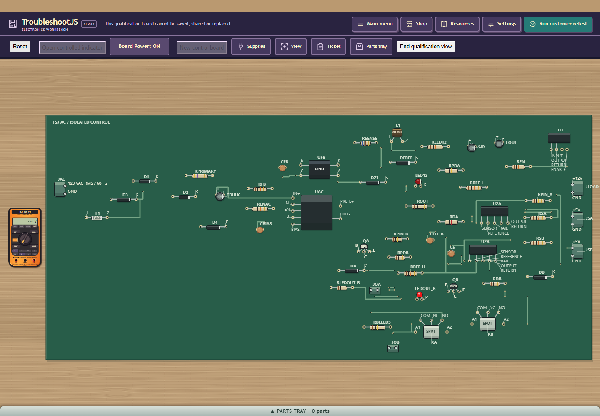
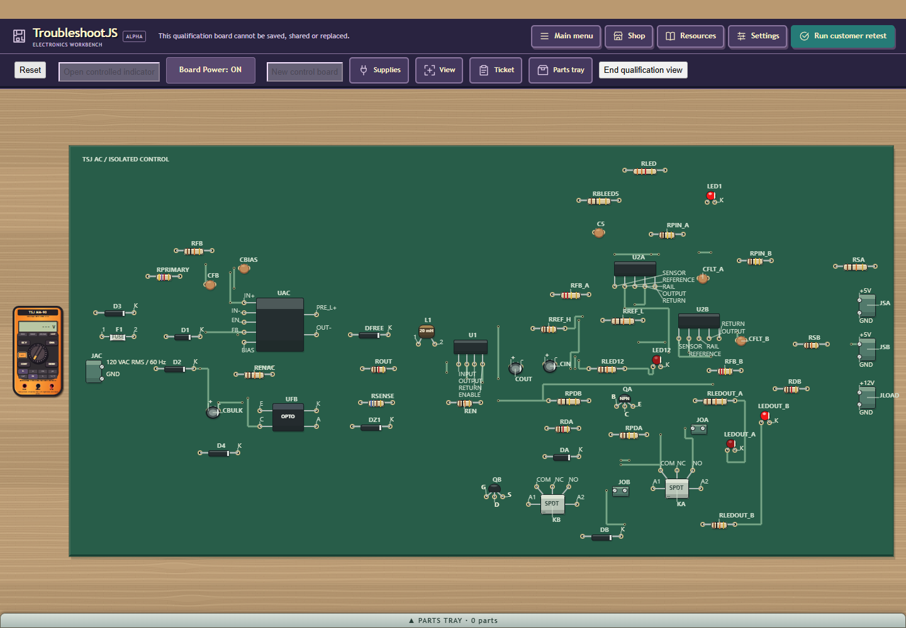
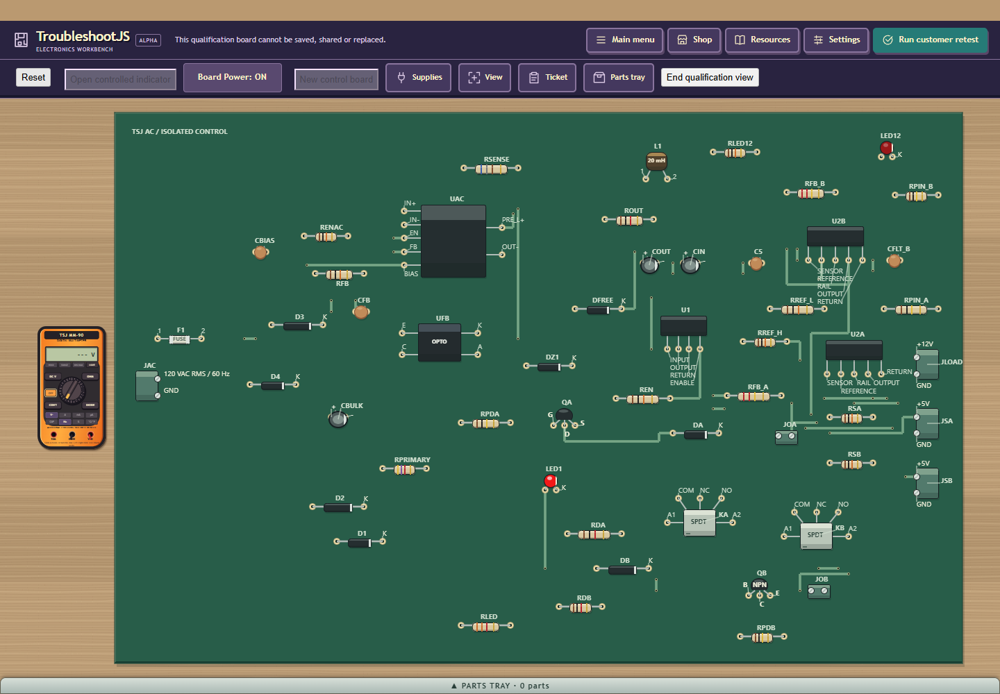

# Remaining PCB regions and rejected completed-graph reflow

Published private6 remains the implementation. No version7 product change is
accepted. This assessment identifies the remaining physical/algorithmic limits
and records one deliberately rejected trial rather than another small metric gain.

| Parts | Protected-free cells | Largest protected empty rectangle | Share of outline |
| --- | --- | --- | --- |
| 53 | 54.80% | 2030 x 900 | 23.70% |
| 60 | 56.87% | 1310 x 670 | 10.39% |
| 54 | 47.56% | 650 x 910 | 9.28% |
| 40 | 49.39% | 1390 x 320 | 8.68% |
| 42 | 47.31% | 570 x 660 | 8.04% |
| 44 | 41.90% | 840 x 210 | 3.82% |

The largest region is53's lower-left2030 x900 gap;60's is upper-middle1310 x670;
54's is a lower-left650 x910 strip. These are actual10-unit grid measurements
reserving package/access, both copper faces, vias, model labels and isolation.
They are not proof of packability or removable rectangular outline area.
Full package/access occupancy is36.62%/36.21% on53/60, rather than just their
13.0%/12.6% courtyard-area fractions. Root inspected the actual retained images.
53 uses the older220/5 fit inset; all three images have exact current6 world
geometry verified by published native212 hashes and saved5 oracles. No trial7 browser image
or physical size reduction is implied by those baseline screenshots.

The common80-unit PRIMARY/SECONDARY courtyard corridor, inward edge ports,
full escape/access envelopes and legal two-layer routing are binding checks.
Secondary circuitry cannot simply fill a primary-side green patch. The existing
compactor only removes completely unoccupied x/y strips. Its batch-axis rollback
may lose other safe cuts, but current evidence does not establish that cause.

One private7 experiment revisited every non-anchor with the completed graph,
using the existing local score/rings/fit tests and a current legal pose baseline.
It kept anchors/candidate5 unchanged, the same60000 evaluations per placement
plan, six placements and three routes per policy. Native213 PASS37.403s: actual
53/60 P07/admission578 assertions and unchanged model backing205; source and
owned resource cleanup PASS. Aggregate evaluation counts across six placement
plans are not the60000 per-plan cap. Results:

| Parts | Prior area | Trial area | Outline change | Largest empty rectangle change | Copper length change |
| --- | --- | --- | --- | --- | --- |
| 60 | 8443994 | 8423454 | -0.24% | -44.15% | +2.48% |
| 53 | 7708262 | 7708262 | 0.00% | 0.00% | +0.42% |

53's large gap and outline remain;60's rectangle metric changed without a
meaningful outline improvement. Group extent/copper also worsened. Structural
PASS did not count as density acceptance. Root REJECTED the candidate before
broader native214, GWT60, browser, file or side-service gates. All eleven trial
files and its raw diff are preserved in task storage. Only task-owned changes
were restored/moved; accepted6's twenty raw source/test/owner hashes match exactly.
No public/private7 save is shipped or compatibility promise introduced.

Backside poses, mirrored pad coordinates, face switching, PTH access and side
fingerprints already exist. RB56 packages still allow TOP only, and the planner's
envelope checks are planar. Generic opposite-face body overlap checks do not
provide an explicit through-hole tail versus opposite-body/probe/service guard.
A credible backside slice needs versioned private capabilities, conservative
cross-face lead/access shadows, and actual flip/probe/Shop repair/save proofs.
Changing global allowed-side lists also changes package dependency bytes.

The evidence currently favors domain-aware2D packing first: narrow the primary
entry/conversion/feedback strip and align UAC/UFB's isolation boundary with the
secondary groups using full package demand. That addresses uneven domain/port
spread; another face does not waive the common corridor. This is an inference
from current code/geometry, not a benchmarked backside or optimal-packing result.
Avoid another generic local-score/spacing-factor sweep. No new framework or
mechanical manufacturing rating is proposed.

The only new heavy gate began after04:00UTC; the03:59 sample showed4% CPU/no
competing build processes. No unrelated process/focus/ADB/tablet changes. Original
eight untracked files remain byte-exact/unstaged; all owned work retired.
Human U05/normal population NOT RUN, HARD/normal RB56 HELD, modest-host owner-
deferred; additional30% remains open. No unchanged Q30 corpus/build/browser loop,
email, main merge or Core/Android work. All historical failures and Q30 risks remain.

